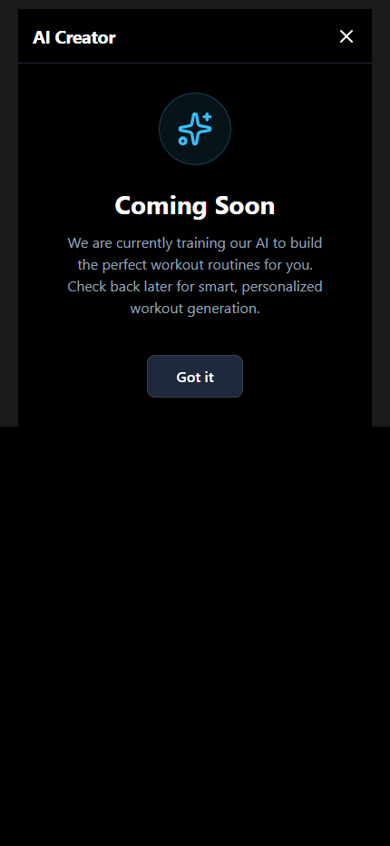

<div align="center">
  

  <h1>FlexTrack</h1>
  <p><strong>AI-powered fitness tracker built with React Native & Expo</strong></p>

  <p>
    
    
    
    
    
    
    
  </p>
</div>

---

## Overview

FlexTrack is a mobile fitness tracking application that helps you plan, execute, and analyse your training. It comes with an AI workout generator powered by Google Gemini, a full active-workout experience with per-set logging, and a rich stats dashboard — all stored locally on device with no account required.

---

## Screenshots

> **Note:** Run the app and capture screenshots, then place them in a `docs/screenshots/` folder and update the paths below.

<div align="center">
<table>
  <tr>
    <td align="center"><b>Dashboard</b></td>
    <td align="center"><b>Active Workout</b></td>
    <td align="center"><b>Workout Summary</b></td>
    <td align="center"><b>History</b></td>
  </tr>
  <tr>
    <td></td>
    <td></td>
    <td></td>
    <td></td>
  </tr>
  <tr>
    <td align="center"><b>Stats</b></td>
    <td align="center"><b>Template Editor</b></td>
    <td align="center"><b>AI Creator</b></td>
    <td align="center"><b>Body Metrics</b></td>
  </tr>
  <tr>
    <td></td>
    <td></td>
    <td></td>
    <td></td>
  </tr>
</table>
</div>

---

## Features

### Dashboard
- **Weekly schedule** — view which workouts are planned for each day of the week
- **Today's focus card** — highlights workouts scheduled for today with a one-tap start
- **Template quick-launch** — shows your top 3 templates with a contextual action sheet (Start / Edit) and a "View All" shortcut when you have more than 3

### Workout Templates
- Create and edit fully custom workout templates
- Add exercises of three types: **Reps**, **Timer**, or **Distance**
- Configure per-exercise targets: sets, reps, weight, rest time, notes
- Assign workouts to specific days of the week for schedule planning

### Active Workout
- Step-by-step exercise navigator with per-set logging
- Inline weight / reps / duration / distance input per set
- **Previous session reference** — shows your last logged numbers for each set as a ghost value
- Per-set notes
- **Rest timer** — integrated countdown with vibration feedback; adjustable ±15 s
- **Timer mode** for timed exercises (stopwatch per set)
- **Haptic feedback** on set completion
- Screen stays awake during a session (`expo-keep-awake`)
- Hardware back-button guard with discard confirmation

### Post-Workout Summary
- Automatically shown after finishing a workout
- Displays: total duration, exercises completed, total sets done, total volume lifted
- Per-exercise completion breakdown with completion indicator
- One-tap "Done" button navigates to History

### History
- **28-day activity heatmap** showing training frequency at a glance
- Stats row: total workouts · average session duration · current streak 🔥
- Filter logs by template name via scrollable chip bar
- Logs grouped by month, newest first
- Each log card shows: template name, date, duration, total volume, completed exercises, and exercise tags

### Stats — Training Tab
- **Dynamic Personal Records** — automatically discovers the heaviest lift across all your exercises (top 8, sorted by weight); no hardcoded exercise list
- **Consistency chart** — 14-day bar chart of daily workout frequency (locale-safe date comparison)
- **Training split pie chart** — Push / Pull / Legs / Cardio breakdown
- **Progression chart** — line chart of weight or estimated 1-rep max over time for any exercise; exercise picker modal

### Stats — Body Tab
- Log body weight over time
- Log height
- **BMI calculator** with colour-coded status (Underweight / Healthy / Overweight / Obese)
- Weight-over-time line chart

### AI Workout Creator
- Describe a workout in plain language (e.g. "a 45-minute upper body push day")
- Powered by **Google Gemini 1.5 Flash** with a structured JSON schema response
- Generated template is fully editable before saving
- User-friendly error messages for quota limits, network errors, and safety filters

### Navigation
- Five-tab bottom navigation bar: Schedule · Workouts · **AI** (FAB) · History · Stats
- Active tab highlighted in primary blue
- **Haptic selection feedback** on every tab press
- Navigation bar hidden during active workout and AI creator screens

---

## Tech Stack

| Layer | Technology |
|---|---|
| Framework | React Native 0.81 + Expo 54 |
| UI library | React 19 |
| Language | TypeScript 5.9 |
| Web bundler | Vite 6 + `react-native-web` |
| Navigation | Manual view-state (`useState`) in `App.tsx` |
| Persistence | `@react-native-async-storage/async-storage` |
| AI | Google Gemini 1.5 Flash (`@google/generative-ai`) |
| Charts | `react-native-chart-kit` + `react-native-svg` |
| Date utilities | `date-fns` |
| Icons | `lucide-react-native` |
| Haptics | `expo-haptics` |
| Gradients | `expo-linear-gradient` |
| Screen awake | `expo-keep-awake` |
| Architecture | React Native New Architecture (enabled) |
| Compiler | React Compiler (experimental, enabled) |

---

## Project Structure

```
flex-track/
├── App.tsx                     # Root component, view-state router
├── types/
│   └── index.ts                # All shared TypeScript types
├── hooks/
│   ├── useWorkoutData.ts       # AsyncStorage CRUD for templates, logs, profile
│   └── useWorkoutTimer.ts      # Per-exercise timers and rest countdown
├── services/
│   └── geminiService.ts        # Gemini API integration
├── utils/
│   ├── helpers.ts              # generateId()
│   ├── time.ts                 # formatTime(), parseTimeString()
│   ├── formatters.ts           # Day name helpers
│   └── constants.ts
├── components/
│   └── layout/
│       ├── Navigation.tsx      # Bottom tab bar + FAB
│       └── Header.tsx
└── pages/
    ├── Dashboard/
    │   ├── DashboardPage.tsx
    │   ├── WeeklySchedule.tsx
    │   └── TodayFocusCard.tsx
    ├── Templates/
    │   ├── TemplatesPage.tsx
    │   ├── TemplateEditor.tsx
    │   └── WorkoutCard.tsx
    ├── ActiveWorkout/
    │   ├── ActiveWorkoutPage.tsx
    │   ├── WorkoutSummaryPage.tsx
    │   ├── ExerciseView.tsx
    │   ├── SetList.tsx
    │   └── RestControl.tsx
    ├── History/
    │   ├── HistoryPage.tsx
    │   └── LogItem.tsx
    ├── Stats/
    │   ├── StatsPage.tsx
    │   ├── TrainingTab.tsx
    │   └── BodyTab.tsx
    └── AICreator/
        └── AICreatorPage.tsx
```

---

## Data Model

```typescript
WorkoutTemplate {
  id, name, description?,
  exercises: Exercise[],
  tags?: string[],
  scheduleDays?: number[]   // 0 = Sun … 6 = Sat
}

Exercise {
  id, name,
  type: 'reps' | 'timer' | 'distance',
  targetSets?, targetReps?, targetWeight?,
  targetDurationSeconds?, targetDistance?,
  restSeconds?, notes?
}

WorkoutLog {
  id, templateId, templateName,
  startTime: number,        // Unix ms
  endTime?: number,
  exercises: ExerciseLog[]
}

ExerciseLog {
  exerciseId, exerciseName,
  sets: SetLog[],
  completed: boolean
}

SetLog {
  setNumber, reps?, weight?,
  distance?, durationSeconds?,
  completed: boolean, notes?
}
```

---

## Getting Started

### Prerequisites

- [Node.js](https://nodejs.org/) v20+
- For mobile: [Expo Go](https://expo.dev/client) on your physical device, **or** an iOS Simulator / Android Emulator

### Installation

```bash
# Clone the repository
git clone https://github.com/your-username/flextrack.git
cd flextrack/flex-track

# Install dependencies
npm install
```

### Environment Variables

Create a `.env` file in `flex-track/`:

```env
GEMINI_API_KEY=your_gemini_api_key_here
```

Get a free API key at [Google AI Studio](https://aistudio.google.com/app/apikey).

> The AI Creator feature is the only part that requires the API key. All other features work fully offline.

### Running the App

**Web (Vite — recommended for development):**

```bash
npm run dev
```

Open [http://localhost:3000](http://localhost:3000) in your browser.

**Mobile (Expo):**

```bash
npx expo start
```

Then:
- **Physical device:** Scan the QR code with the Expo Go app
- **iOS Simulator:** Press `i`
- **Android Emulator:** Press `a`

---

## Building for Production

**Web:**

```bash
npm run build      # outputs to dist/
npm run preview    # preview the production build locally
```

**Mobile (via EAS):**

```bash
# Install EAS CLI
npm install -g eas-cli

# Log in to Expo
eas login

# Build for Android (APK)
eas build --platform android --profile preview

# Build for iOS (requires Apple Developer account)
eas build --platform ios
```

Configuration is in `eas.json`.

---

## Architecture Notes

**State management** is intentionally simple: a single `useState<ViewState>` in `App.tsx` drives which screen renders. There is no Redux, Zustand, or React Context. This keeps the codebase easy to follow and fast to navigate.

**Persistence** is handled entirely by `useWorkoutData`, a single hook that reads/writes three AsyncStorage keys on mount and after every mutation: `workout-templates`, `workout-logs`, `user-profile`. No sync layer or remote database is involved.

**Performance** — expensive derivations (stats, filter options, streak, PRs, chart data) are wrapped in `useMemo` so they only recompute when their data dependencies change, not on every render.

---

## Contributing

1. Fork the repository
2. Create a feature branch: `git checkout -b feature/my-feature`
3. Commit your changes: `git commit -m "feat: add my feature"`
4. Push to the branch: `git push origin feature/my-feature`
5. Open a Pull Request

---

## License

This project is licensed under the MIT License.

---

<div align="center">
  <sub>Built with React Native · Expo · TypeScript · Google Gemini</sub>
</div>
