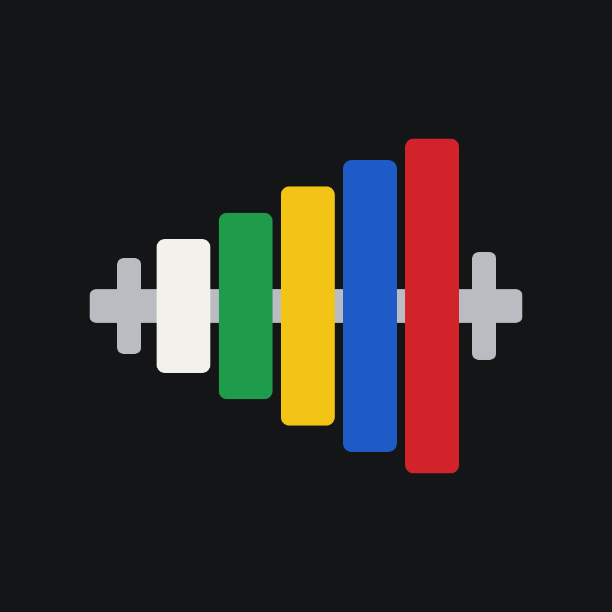
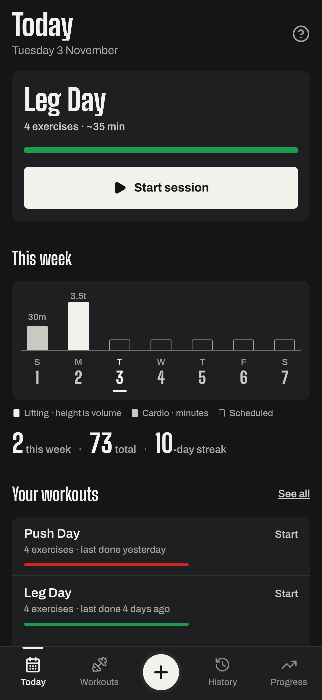
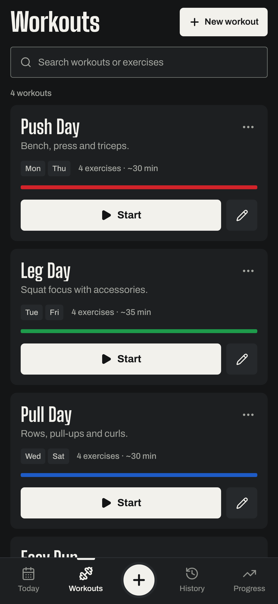
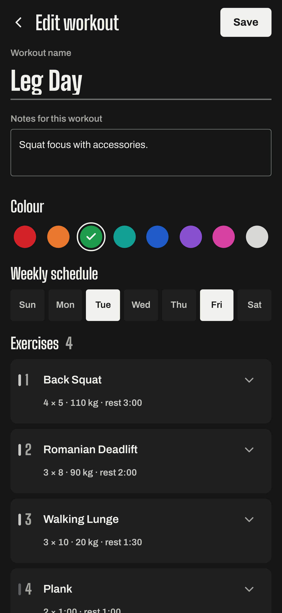
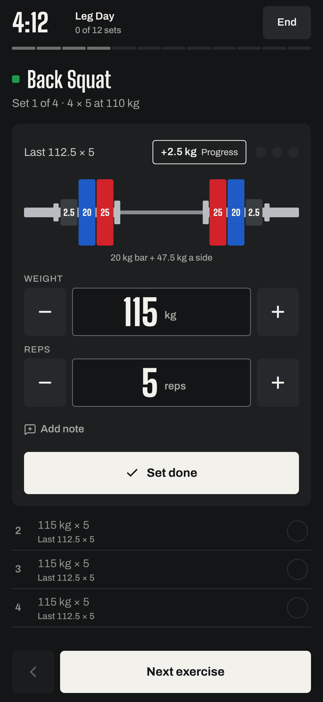
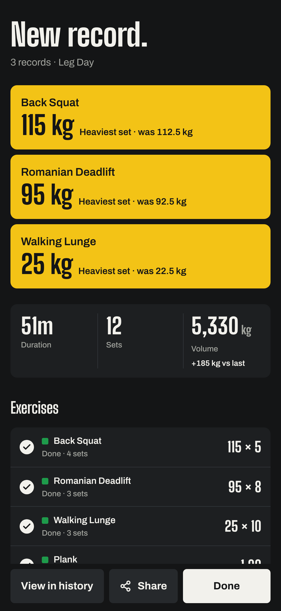
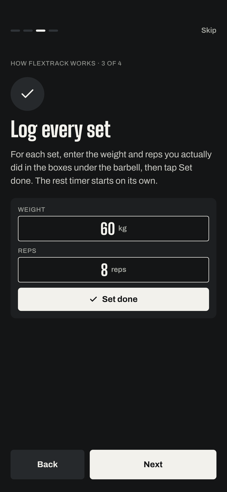
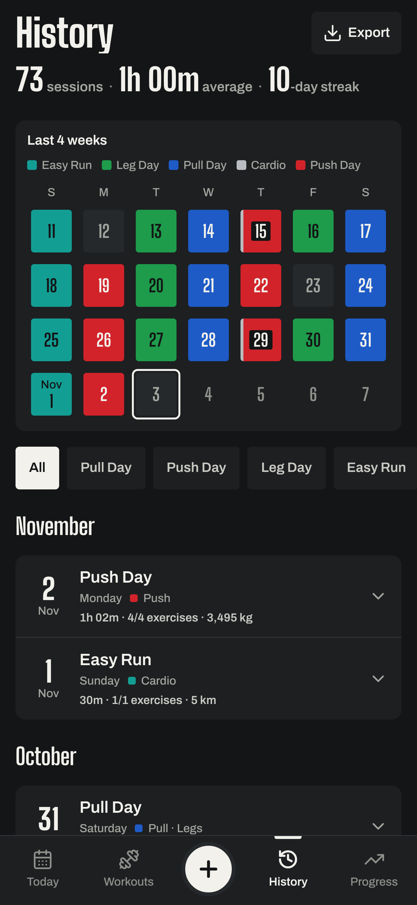
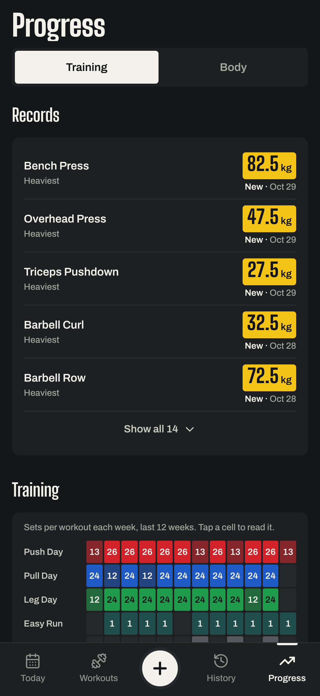
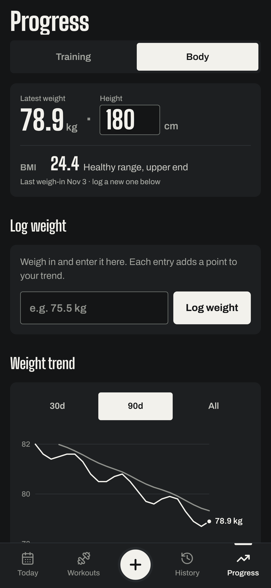

<div align="center">
  

  <h1>FlexTrack</h1>
  <p><strong>Local-first fitness tracker built with React Native & Expo</strong></p>

  <p>
    
    
    
    
    
    
    
  </p>
</div>

---

## Overview

FlexTrack is a mobile fitness tracking application that helps you plan, execute, and analyse your training. It includes a full active-workout experience with per-set logging, a colour for each of your workouts, and a rich progress dashboard. Finished workouts can sync to Apple Health or Health Connect, and home-screen widgets plus Apple Watch and Wear OS apps show your streak and today's workout. Everything is stored locally on the device, with no account required.

---

## Current app

<div align="center">
<table>
  <tr>
    <td align="center"><b>Today</b></td>
    <td align="center"><b>Workouts</b></td>
    <td align="center"><b>Workout Editor</b></td>
  </tr>
  <tr>
    <td></td>
    <td></td>
    <td></td>
  </tr>
  <tr>
    <td align="center"><b>Active Session</b></td>
    <td align="center"><b>Session Summary</b></td>
    <td align="center"><b>First-run Tour</b></td>
  </tr>
  <tr>
    <td></td>
    <td></td>
    <td></td>
  </tr>
  <tr>
    <td align="center"><b>History</b></td>
    <td align="center"><b>Training Progress</b></td>
    <td align="center"><b>Body Metrics</b></td>
  </tr>
  <tr>
    <td></td>
    <td></td>
    <td></td>
  </tr>
</table>
</div>

The screenshots use a 430 × 932 mobile viewport and are stored at 3× resolution (1290 × 2796). They use deterministic local demo data (four workouts and eleven weeks of history) against the current web app, in dark mode.

---

## Features

### First run

- A new install starts empty: no workouts or history you didn't create
- The empty Today card offers to create a workout, add a sample one ("Full Body A") to try a session first, or restore a backup from another phone
- A four-step tour explains building a workout, starting it from Today, logging a set and where results go; it opens on first launch and again from the **?** button on Today

### Today and scheduling

- Highlights the workout scheduled for today with one-tap start, or the next scheduled one on a rest day
- Shows a seven-day chart of this week's volume and cardio minutes, with scheduled days marked
- Shows sessions this week, total sessions and the current streak, plus shortcuts to your workouts
- Offers to resume a session that was interrupted, even after the app was killed

### Workouts

- Create, edit, search, start, and delete reusable workouts (called routines in the code)
- Give each workout one of eight colours; a new workout gets the first colour not already used, and the colour follows it across Today, History and Progress
- Mix repetition, timed, and distance exercises in one workout
- Configure sets, reps, weight or assistance, duration, distance units, rest time, and weekly schedule
- Support weighted, bodyweight, and assisted repetition exercises

### Guided workouts

- Log every set in labelled **Weight** and **Reps** boxes (or Assistance, or just Reps for bodyweight), with a hint on the first set of a new exercise
- Compare a set with values from the previous matching session, and get a suggested weight increase when you hit your targets
- Mark sets individually or complete all sets in an exercise
- Update an exercise's default weight during a session
- See the bar loaded plate by plate for the working weight, with ±2.5 kg steppers
- Run per-set timers and an adjustable rest countdown with vibration feedback and a notification when rest ends
- Keep the screen awake and guard against accidentally leaving a session
- Review duration, sets, volume against last time, new records and per-exercise results after saving, and share the session as an image

### Quick Log

- Record an activity that was completed outside a workout
- Supports strength, run, walk, cycle, timed, and other activities
- Captures completion time, duration, distance and unit when relevant, plus notes
- Adds the activity directly to History and Progress

### History

- Browse a tappable four-week calendar where each day is coloured by the workout trained (quick-logged cardio in grey)
- See total sessions, average duration, and current streak
- Filter by workout or a selected day
- Review sessions grouped by month with duration, volume, and exercise details
- Back up every workout, session and body-weight entry as one JSON file from the History header's **Backup** button, and restore that file on any device. Restoring only adds: anything already on the device is never replaced or removed, so restoring the same file twice adds nothing
- Turn on Apple Health or Health Connect sync from the heart button (see [Health sync](#health-sync))

### Progress

- Derives personal records from the exercise data actually logged
- Shows a 12-week heat strip of weekly sets per workout, in each workout's colour, with quick-logged cardio and other activity in their own rows
- Charts progression for a selected exercise, with records marked
- Chooses metrics for each modality, including weight, estimated 1RM, reps, assistance, duration, distance, and pace
- Logs height and body weight: the big **Latest weight** number is a readout, and tapping it jumps to the log field below
- Explains BMI in words and charts weight over 30 days, 90 days or all time

### Beyond the app

- **Health sync:** finished workouts written to Apple Health or Health Connect, off by default
- **Home-screen widgets:** Streak and Next workout, on iOS and Android
- **Watch apps:** Apple Watch and Wear OS apps with your streak and today's workout

### Navigation and feedback

- Bottom tabs for Today, Workouts, History, and Progress
- Central Quick Start sheet for launching workouts, logging completed activity, or creating a workout
- Haptic feedback for navigation, workout starts, and completed sets on supported devices
- Focused full-screen layouts for workout editing, active workouts, summaries, and Quick Log

---

## Tech Stack

| Layer | Technology |
|---|---|
| Framework | React Native 0.88 + Expo SDK 58 |
| UI library | React 19.3 |
| Language | TypeScript 6.0 |
| Web bundler | Vite 6 + `react-native-web` |
| Navigation | Manual view-state (`useState`) in `App.tsx` |
| Persistence | `@react-native-async-storage/async-storage` |
| Charts | Hand-built with `react-native-svg` |
| Date utilities | `date-fns` |
| Icons | `lucide-react-native` |
| Haptics | `expo-haptics` |
| Gradients | `expo-linear-gradient` |
| Screen awake | `expo-keep-awake` |
| Fonts | Big Shoulders Display + Archivo via `expo-font` |
| Health sync | `@kingstinct/react-native-healthkit` (iOS), `react-native-health-connect` (Android) |
| Widgets | `@bacons/apple-targets` (iOS, SwiftUI), `react-native-android-widget` |
| Watch apps | SwiftUI (watchOS), Kotlin (Wear OS), bridged by the local `modules/flextrack-watch` |
| E2E tests | Maestro |
| Architecture | React Native New Architecture (enabled) |
| Compiler | React Compiler (experimental, enabled) |

---

## Project Structure

```
FlexTrack/
├── App.tsx                     # Root view-state router, data wiring and first-run tour
├── constants/
│   └── theme.ts                # Shared colors, type, spacing, and shadows
├── types/
│   └── index.ts                # Workouts, exercises, logs, profile, and views
├── hooks/
│   ├── useWorkoutDataSafe.ts   # Validated, serialized AsyncStorage operations
│   ├── useWorkoutTimer.ts      # Exercise timers and rest countdown
│   ├── useHealthSync.ts        # Apple Health / Health Connect opt-in and writes
│   └── useWidgetSync.ts        # Keeps widget and watch snapshots up to date
├── utils/
│   ├── storage.ts              # Storage layout, migration and the sample workout
│   ├── sanitize.ts             # Validation and bounds for stored data
│   ├── workoutColor.ts         # The workout colour palette and how logs pick a colour
│   ├── training.ts             # Records, volume, streak and plate maths
│   ├── progress.ts             # Modality-aware progress calculations
│   ├── progression.ts          # Next-session weight suggestions
│   ├── healthSync.ts           # Health store writes (platform files alongside)
│   ├── widgetData.ts           # Widget snapshot (bridges per platform alongside)
│   ├── watchData.ts            # Watch snapshot with formatted exercises
│   ├── exportData.ts           # JSON export through the share sheet
│   ├── importData.ts           # Reads a backup and plans what it adds
│   ├── pickBackup.ts           # System file picker (or a file input on web)
│   └── time.ts, formatters.ts, helpers.ts
├── components/
│   ├── Onboarding.tsx          # Four-step first-run tour
│   ├── layout/                 # Header and bottom navigation
│   └── ui/                     # Buttons, cards, chips, dialogs and empty states
├── pages/
│   ├── Dashboard/              # Today, this week, and workout shortcuts
│   ├── Templates/              # Workout list and editor (with the colour picker)
│   ├── ActiveWorkout/          # Guided session, set logging, rest, summary and share card
│   ├── QuickLog/               # Completed-activity entry
│   ├── History/                # Workout-coloured calendar, filters, and workout cards
│   └── Stats/                  # Training progress, heat strip, and body metrics
├── targets/
│   ├── widget/                 # iOS home-screen widgets (SwiftUI)
│   └── watch/                  # Apple Watch app (SwiftUI)
├── wear/                       # Wear OS app (Kotlin)
├── widgets/                    # Android home-screen widgets
├── modules/flextrack-watch/    # Native phone-to-watch bridge
├── plugins/                    # Expo config plugins (Wear module, pod target, storage size)
├── assets/images/source/       # SVG sources for the icon, adaptive layers and splash
├── tests/                      # Vitest unit tests
├── .maestro/                   # Maestro end-to-end flows
└── .github/workflows/          # CI, E2E and the manual EAS build
```

---

## Data Model

```typescript
WorkoutTemplate {
  id, name, description?,
  exercises: Exercise[],
  tags?: string[],
  scheduleDays?: number[],  // 0 = Sun … 6 = Sat
  color?: string            // 'red' | 'orange' | 'green' | 'teal' | 'blue' | 'purple' | 'pink' | 'chalk'
}

Exercise {
  id, name,
  type: 'reps' | 'timer' | 'distance',
  loadMode?: 'external' | 'bodyweight' | 'assisted',
  targetSets?, targetReps?, targetWeight?,
  targetDurationSeconds?, targetDistance?, targetDistanceUnit?,
  restSeconds?, notes?
}

WorkoutLog {
  id, templateId?, templateName,
  source?: 'routine' | 'quick',
  activityCategory?: 'strength' | 'run' | 'walk' | 'cycle' | 'timed' | 'other',
  color?: string,           // the workout's colour when the session was logged
  notes?,
  startTime: number,        // Unix ms
  endTime?: number,
  exercises: ExerciseLog[]
}

ExerciseLog {
  exerciseId, exerciseName,
  exerciseType?, loadMode?, distanceUnit?,
  sets: SetLog[],
  completed: boolean
}

SetLog {
  setNumber, reps?, weight?,
  distance?, durationSeconds?,
  completed: boolean, notes?
}

UserProfile {
  height?: number,         // centimetres
  weightLogs: { date: number, weight: number }[] // kilograms
}
```

---

## Getting Started

### Prerequisites

- [Node.js](https://nodejs.org/) v22.13+
- For mobile: a development build (see below), on a physical device or an iOS Simulator / Android Emulator. Expo Go can't load the Apple Health and Health Connect modules.

### Installation

```bash
# Clone the repository
git clone https://github.com/HatefulRock/FlexTrack.git
cd FlexTrack

# Install dependencies
npm install
```

### Running the App

**Web (Vite — recommended for development):**

```bash
npm run dev
```

Open [http://localhost:3000](http://localhost:3000) in your browser.

**Mobile (Expo):**

```bash
# Once, and again after native dependencies change
eas build --profile development --platform ios      # or android
npx expo start --dev-client
```

Then:
- **Physical device:** Install the development build, then scan the QR code
- **iOS Simulator:** Press `i`
- **Android Emulator:** Press `a`

---

## Building for Production

**Web:**

```bash
npm run build      # outputs to dist/
npm run preview    # preview the production build locally
```

**Tests:** `npm test` runs the Vitest unit tests in `tests/`. CI also runs typecheck, lint, the web build and a native iOS/Android bundle.

**Mobile (via EAS):**

```bash
# Install EAS CLI
npm install -g eas-cli

# Log in to Expo
eas login

# Build for Android (APK)
eas build --platform android --profile preview

# Build for iOS (requires Apple Developer account)
eas build --platform ios --profile production

# Upload the latest build to App Store Connect
eas submit --platform ios
```

Configuration is in `eas.json`. Production builds bump the version code on Expo's side (`autoIncrement` with a remote app version).

**EAS build from GitHub:** the **EAS build** workflow (`.github/workflows/eas-build.yml`) starts a build on Expo's servers from the Actions tab. Pick a platform (`android`, `ios` or `all`) and a profile (`production`, `preview` or `wear`). It needs an `EXPO_TOKEN` repository secret (expo.dev, Account settings, Access tokens), plus `APPLE_TEAM_ID` for iOS builds. The build is queued and the job exits; follow it on expo.dev.

---

## Health, widgets and watch apps

### Health sync

History has a heart button that turns on writing finished workouts to Apple Health (iOS) or Health Connect (Android). It is off by default, writes workouts only and never reads health data. Each workout carries its FlexTrack id as a sync identifier, so resending never duplicates. Watches and apps that read these stores (Garmin Connect, Fitbit, Samsung Health, Strava) see the workouts from there. Health Connect needs Android 8 (API 26) or later. Before release, the Play Console health permissions declaration and the privacy policy need to cover this.

### Home-screen widgets

A Streak widget and a Next workout widget, on iOS and Android. The app writes a small snapshot of training days and scheduled workouts whenever history or workouts change. On iOS it goes to the `group.com.HatefulRock.flextrack` App Group, and on Android it goes to local storage. The widgets compute the streak and the next workout from that snapshot, so they stay correct after midnight without the app opening. The iOS widget is SwiftUI in `targets/widget/`, built by `@bacons/apple-targets`, and signs with the team in the `APPLE_TEAM_ID` environment variable, read by `app.config.ts`. Put it in `.env.local` (gitignored) for local builds and in the project's EAS environment variables for cloud builds, so it stays out of the repo. The Android widgets are drawn from `widgets/AndroidWidgets.tsx` by `react-native-android-widget`.

### Watch apps

The Apple Watch app (`targets/watch/`, SwiftUI) and the Wear OS app (`wear/`, Kotlin) show your streak and today's workout, with each exercise's target. The phone sends them the same kind of snapshot as the widgets, plus the formatted exercises (`utils/watchData.ts`). It goes through WatchConnectivity on iOS and the Wear OS Data Layer on Android, both in the local module `modules/flextrack-watch`. Nothing passes through a server. The watch app is built and submitted with the iOS app. The Wear OS app is a separate module that `plugins/withWearApp.cjs` adds to the Android project. Build it with `eas build --platform android --profile wear` and upload it to the same Play listing under the Wear OS form factor. It must be signed with the phone app's key, and its version code (Gradle property `flextrackWearVersionCode`, default 100001) must differ from the phone app's.

### Store listings

The privacy policy for the store listings is at <https://hatefulrock.github.io/apps/flextrack/privacy/> and the support page at <https://hatefulrock.github.io/apps/flextrack/>.

### App icon

The icon is a loaded barbell centred in the tile. The icon, Android adaptive and monochrome layers, splash mark and favicon are all exported from the SVGs in `assets/images/source/`, so change those and regenerate the PNGs rather than editing the PNGs directly.

---

## End-to-end tests

User flows live in `.maestro/` and run with [Maestro](https://maestro.mobile.dev). Each flow starts from a wiped install and drives the real app through a journey a user would take: first launch and the tour, building a workout, finishing a workout, resuming after the app is killed, quick-logging, body weight, and the edge cases around each.

```bash
npx expo run:android --variant release   # build and install once (a release build needs no Metro)
npm run e2e                              # every flow
npm run e2e:smoke                        # the tagged smoke subset
maestro test .maestro/flows/04-complete-workout.yaml
```

Maestro matches an iOS element by its accessibility label only, so flows assert on labels such as "Edit workout X" rather than text inside a labelled button.

Flows tagged `android-only` press the hardware back key. `npm run e2e:ios` skips them and runs the rest on an iOS simulator, and `npm run e2e:corrupt` checks how the app copes with unreadable stored workouts (it needs `adb root`, so a Google APIs emulator image). CI runs the Android smoke flows on pull requests, and the full Android suite plus iOS nightly.

Flows match on accessibility labels, so renaming a label means updating the flows that use it. If several devices are connected, pass `--device <id>`. Shared steps are in `.maestro/subflows/`; `skip-tour.yaml` dismisses the first-run tour and `launch-starter.yaml` adds the sample workout.

## Architecture Notes

**State management** is intentionally simple: local React state in `App.tsx` drives the current screen and active session. There is no Redux, Zustand, or application context.

**Persistence** is handled by `useWorkoutDataSafe` and `utils/storage.ts`, which validate and bound stored values and serialize writes. Workouts live in `workout-templates`, the profile in `user-profile`, and each session in its own `workout-log:<id>` key, so no single value outgrows Android's per-row read limit. Older installs that kept every session in `workout-logs` are migrated on launch. `onboarding-seen` records that the tour was shown. A stored value that can't be read is left untouched, never overwritten, and included in exports so it can be recovered. No sync layer or remote database is involved.

**Performance** — expensive derivations are memoized, and the chart-heavy Stats screen is loaded only when opened.

### Current boundaries

- Data is local to the current browser or device; there is no account, cloud sync, or remote database. A backup file is the only way to move it between devices.
- Exercise categories (push, pull, legs) shown in the editor's exercise picker are inferred from exercise names.

---

## Contributing

1. Fork the repository
2. Create a feature branch: `git checkout -b feature/my-feature`
3. Commit your changes: `git commit -m "feat: add my feature"`
4. Push to the branch: `git push origin feature/my-feature`
5. Open a Pull Request

---

## License

This project is licensed under the MIT License.

---

<div align="center">
  <sub>Built with React Native · Expo · TypeScript</sub>
</div>
