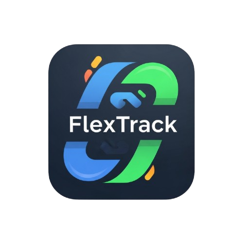
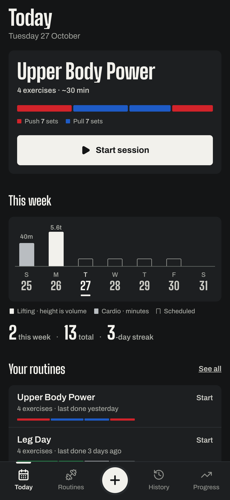
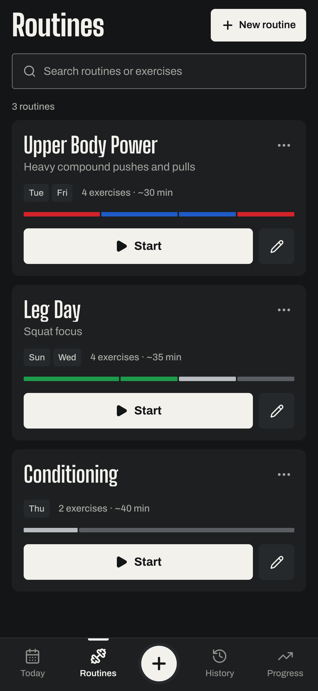
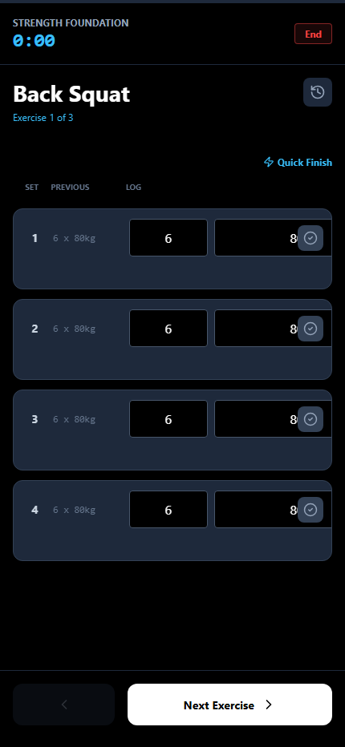
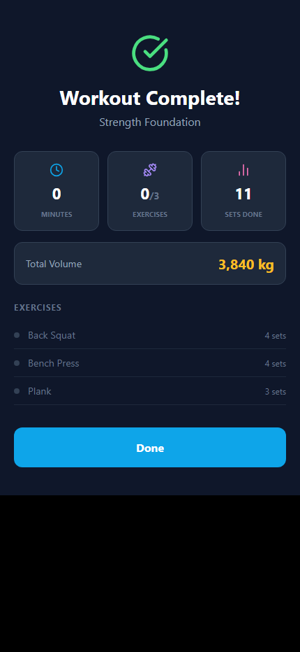
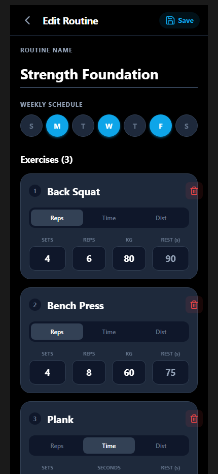
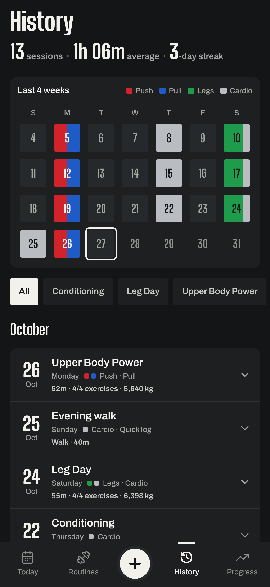
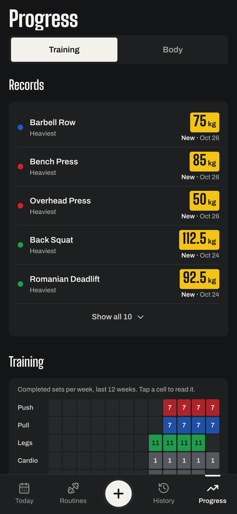
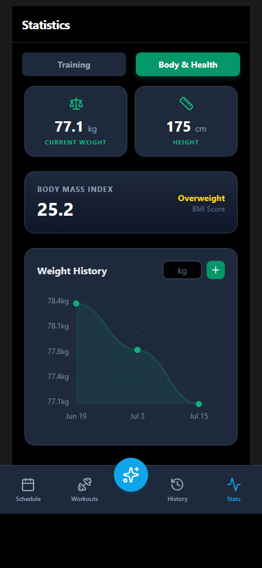

<div align="center">
  

  <h1>FlexTrack</h1>
  <p><strong>Local-first fitness tracker built with React Native & Expo</strong></p>

  <p>
    
    
    
    
    
    
  </p>
</div>

---

## Overview

FlexTrack is a mobile fitness tracking application that helps you plan, execute, and analyse your training. It includes a full active-workout experience with per-set logging and a rich stats dashboard — all stored locally on device with no account required.

---

## Current app

<div align="center">
<table>
  <tr>
    <td align="center"><b>Today</b></td>
    <td align="center"><b>Routines</b></td>
    <td align="center"><b>Active Session</b></td>
    <td align="center"><b>Session Summary</b></td>
  </tr>
  <tr>
    <td></td>
    <td></td>
    <td></td>
    <td></td>
  </tr>
  <tr>
    <td align="center"><b>Routine Editor</b></td>
    <td align="center"><b>History</b></td>
    <td align="center"><b>Training Progress</b></td>
    <td align="center"><b>Body Metrics</b></td>
  </tr>
  <tr>
    <td></td>
    <td></td>
    <td></td>
    <td></td>
  </tr>
</table>
</div>

The screenshots use a 430 × 932 mobile viewport and are stored at 3× resolution (1290 × 2796). They use deterministic local demo data against the current web app.

---

## Features

### Today and scheduling

- Highlights a routine scheduled for today with one-tap start
- Shows sessions completed this week and total workout count
- Displays the seven-day routine schedule and quick access to the first three routines

### Workout routines

- Create, edit, search, start, and delete reusable routines
- Mix repetition, timed, and distance exercises in one routine
- Configure sets, reps, weight or assistance, duration, distance units, rest time, and weekly schedule
- Support weighted, bodyweight, and assisted repetition exercises

### Guided workouts

- Log every set with weight, reps, duration, or distance as appropriate
- Compare a set with values from the previous matching session
- Mark sets individually or complete all sets in an exercise
- Update an exercise's default weight during a session
- See the bar loaded plate by plate for the working weight, with ±2.5 kg steppers
- Run per-set timers and an adjustable rest countdown with vibration feedback
- Keep the screen awake and guard against accidentally leaving a session
- Review duration, completed exercises, sets, volume, and per-exercise results after saving

### Quick Log

- Record an activity that was completed outside a routine
- Supports strength, run, walk, cycle, timed, and other activities
- Captures completion time, duration, distance and unit when relevant, plus notes
- Adds the activity directly to History and Progress

### History

- Browse a tappable four-week calendar coloured by what you trained
- See total workouts, average duration, and current streak
- Filter by routine or a selected day
- Review sessions grouped by month with duration, volume, and exercise details
- Export every routine, session and body-weight entry as one JSON file from the History header

### Progress

- Derives personal records from the exercise data actually logged
- Shows a 12-week heat strip of weekly sets per Push / Pull / Legs / Cardio
- Charts progression for a selected exercise, with records marked
- Chooses metrics for each modality, including weight, estimated 1RM, reps, assistance, duration, distance, and pace
- Logs height and body weight, explains BMI in words, and charts weight over 30 days, 90 days or all time

### Navigation and feedback

- Bottom tabs for Today, Routines, History, and Progress
- Central Quick Start sheet for launching routines, logging completed activity, or creating a routine
- Haptic feedback for navigation, workout starts, and completed sets on supported devices
- Focused full-screen layouts for routine editing, active workouts, summaries, and Quick Log

---

## Tech Stack

| Layer | Technology |
|---|---|
| Framework | React Native 0.81 + Expo 54 |
| UI library | React 19 |
| Language | TypeScript 5.9 |
| Web bundler | Vite 6 + `react-native-web` |
| Navigation | Manual view-state (`useState`) in `App.tsx` |
| Persistence | `@react-native-async-storage/async-storage` |
| Charts | Hand-built with `react-native-svg` |
| Date utilities | `date-fns` |
| Icons | `lucide-react-native` |
| Haptics | `expo-haptics` |
| Gradients | `expo-linear-gradient` |
| Screen awake | `expo-keep-awake` |
| Architecture | React Native New Architecture (enabled) |
| Compiler | React Compiler (experimental, enabled) |

---

## Project Structure

```
flex-track/
├── App.tsx                     # Root view-state router and data wiring
├── constants/
│   └── theme.ts                # Shared colors, type, spacing, and shadows
├── types/
│   └── index.ts                # Templates, exercises, logs, profile, and views
├── hooks/
│   ├── useWorkoutDataSafe.ts   # Validated, serialized AsyncStorage operations
│   └── useWorkoutTimer.ts      # Exercise timers and rest countdown
├── utils/
│   ├── progress.ts             # Modality-aware progress calculations
│   ├── exportData.ts           # JSON export through the share sheet
│   ├── time.ts                 # Duration parsing and formatting
│   ├── formatters.ts           # Schedule labels
│   └── helpers.ts              # ID generation
├── components/
│   ├── layout/                 # Header and bottom navigation
│   └── ui/                     # Buttons, cards, chips, and empty states
└── pages/
    ├── Dashboard/              # Today, schedule, and routine shortcuts
    ├── Templates/              # Routine list and editor
    ├── ActiveWorkout/          # Guided session, set logging, rest, and summary
    ├── QuickLog/               # Completed-activity entry
    ├── History/                # Activity grid, filters, and workout cards
    └── Stats/                  # Training progress and body metrics
```

---

## Data Model

```typescript
WorkoutTemplate {
  id, name, description?,
  exercises: Exercise[],
  tags?: string[],
  scheduleDays?: number[]   // 0 = Sun … 6 = Sat
}

Exercise {
  id, name,
  type: 'reps' | 'timer' | 'distance',
  loadMode?: 'external' | 'bodyweight' | 'assisted',
  targetSets?, targetReps?, targetWeight?,
  targetDurationSeconds?, targetDistance?, targetDistanceUnit?,
  restSeconds?, notes?
}

WorkoutLog {
  id, templateId?, templateName,
  source?: 'routine' | 'quick',
  activityCategory?: 'strength' | 'run' | 'walk' | 'cycle' | 'timed' | 'other',
  notes?,
  startTime: number,        // Unix ms
  endTime?: number,
  exercises: ExerciseLog[]
}

ExerciseLog {
  exerciseId, exerciseName,
  exerciseType?, loadMode?, distanceUnit?,
  sets: SetLog[],
  completed: boolean
}

SetLog {
  setNumber, reps?, weight?,
  distance?, durationSeconds?,
  completed: boolean, notes?
}

UserProfile {
  height?: number,         // centimetres
  weightLogs: { date: number, weight: number }[] // kilograms
}
```

---

## Getting Started

### Prerequisites

- [Node.js](https://nodejs.org/) v20+
- For mobile: a development build (see below), on a physical device or an iOS Simulator / Android Emulator. Expo Go can't load the Apple Health and Health Connect modules.

### Installation

```bash
# Clone the repository
git clone https://github.com/HatefulRock/FlexTrack.git
cd flextrack/flex-track

# Install dependencies
npm install
```

### Running the App

**Web (Vite — recommended for development):**

```bash
npm run dev
```

Open [http://localhost:3000](http://localhost:3000) in your browser.

**Mobile (Expo):**

```bash
# Once, and again after native dependencies change
eas build --profile development --platform ios      # or android
npx expo start --dev-client
```

Then:
- **Physical device:** Install the development build, then scan the QR code
- **iOS Simulator:** Press `i`
- **Android Emulator:** Press `a`

---

## Building for Production

**Web:**

```bash
npm run build      # outputs to dist/
npm run preview    # preview the production build locally
```

**Tests:** `npm test` runs the Vitest unit tests in `tests/`. CI also runs typecheck, lint, the web build and a native iOS/Android bundle.

**Mobile (via EAS):**

```bash
# Install EAS CLI
npm install -g eas-cli

# Log in to Expo
eas login

# Build for Android (APK)
eas build --platform android --profile preview

# Build for iOS (requires Apple Developer account)
eas build --platform ios --profile production

# Upload the latest build to App Store Connect
eas submit --platform ios
```

Configuration is in `eas.json`.

**Health sync:** History has a heart button that turns on writing finished workouts to Apple Health (iOS) or Health Connect (Android). It is off by default, writes workouts only and never reads health data. Each workout carries its FlexTrack id as a sync identifier, so resending never duplicates. Watches and apps that read these stores (Garmin Connect, Fitbit, Samsung Health, Strava) see the workouts from there. Health Connect needs Android 8 (API 26) or later. Before release, the Play Console health permissions declaration and the privacy policy need to cover this.

**Home-screen widgets:** a Streak widget and a Next workout widget, on iOS and Android. The app writes a small snapshot of training days and scheduled routines whenever history or routines change. On iOS it goes to the `group.com.HatefulRock.flextrack` App Group, and on Android it goes to local storage. The widgets compute the streak and the next routine from that snapshot, so they stay correct after midnight without the app opening. The iOS widget is SwiftUI in `targets/widget/`, built by `@bacons/apple-targets`, and signs with the team in the `APPLE_TEAM_ID` environment variable, read by `app.config.ts`. Put it in `.env.local` (gitignored) for local builds and in the project's EAS environment variables for cloud builds, so it stays out of the repo. The Android widgets are drawn from `widgets/AndroidWidgets.tsx` by `react-native-android-widget`.

**Watch apps:** the Apple Watch app (`targets/watch/`, SwiftUI) and the Wear OS app (`wear/`, Kotlin) show your streak and today's routine, with each exercise's target. The phone sends them the same kind of snapshot as the widgets, plus the formatted exercises (`utils/watchData.ts`). It goes through WatchConnectivity on iOS and the Wear OS Data Layer on Android, both in the local module `modules/flextrack-watch`. Nothing passes through a server. The watch app is built and submitted with the iOS app. The Wear OS app is a separate module that `plugins/withWearApp.cjs` adds to the Android project. Build it with `eas build --platform android --profile wear` and upload it to the same Play listing under the Wear OS form factor. It must be signed with the phone app's key, and its version code (Gradle property `flextrackWearVersionCode`, default 100001) must differ from the phone app's. The privacy policy for the store listings is at <https://hatefulrock.github.io/apps/flextrack/privacy/> and the support page at <https://hatefulrock.github.io/apps/flextrack/>.

The icon, Android adaptive layers and splash mark are drawn from the SVGs in `assets/images/source/`.

---

## End-to-end tests

User flows live in `.maestro/` and run with [Maestro](https://maestro.mobile.dev). Each flow starts from a wiped install and drives the real app through a journey a user would take: first launch, building a routine, finishing a workout, resuming after the app is killed, quick-logging, body weight, and the edge cases around each.

```bash
npx expo run:android --variant release   # build and install once (a release build needs no Metro)
npm run e2e                              # every flow
npm run e2e:smoke                        # the tagged smoke subset
maestro test .maestro/flows/04-complete-workout.yaml
```

On iOS the app currently crashes at launch on the iOS 27 simulator when built with Xcode 27, because Expo 54 does not adopt the UIScene lifecycle that iOS 27 requires. Run the iOS flows on an iOS 26 simulator until the Expo SDK is upgraded. Maestro matches an iOS element by its accessibility label only, so flows assert on labels such as "Edit routine X" rather than text inside a labelled button.

Flows tagged `android-only` press the hardware back key. `npm run e2e:ios` skips them and runs the rest on an iOS simulator, and `npm run e2e:corrupt` checks how the app copes with unreadable stored routines (it needs `adb root`, so a Google APIs emulator image). CI runs the Android smoke flows on pull requests, and the full Android suite plus iOS nightly.

Flows match on accessibility labels, so renaming a label means updating the flows that use it. If several devices are connected, pass `--device <id>`. Shared steps are in `.maestro/subflows/`.

## Architecture Notes

**State management** is intentionally simple: local React state in `App.tsx` drives the current screen and active session. There is no Redux, Zustand, or application context.

**Persistence** is handled by `useWorkoutDataSafe`, which validates and bounds stored values and serializes writes to the three AsyncStorage keys: `workout-templates`, `workout-logs`, and `user-profile`. No sync layer or remote database is involved.

**Performance** — expensive derivations are memoized, and the chart-heavy Stats screen is loaded only when opened.

### Current boundaries

- Data is local to the current browser or device; there is no account, cloud sync, or remote database. Export is the only way to copy it off the device, and there is no import yet.
- Exercise grouping for the training split is inferred from exercise names.

---

## Contributing

1. Fork the repository
2. Create a feature branch: `git checkout -b feature/my-feature`
3. Commit your changes: `git commit -m "feat: add my feature"`
4. Push to the branch: `git push origin feature/my-feature`
5. Open a Pull Request

---

## License

This project is licensed under the MIT License.

---

<div align="center">
  <sub>Built with React Native · Expo · TypeScript</sub>
</div>
